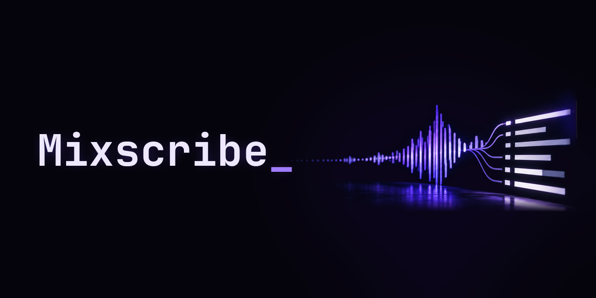

I DJ, and after every set it's the same chore: figuring out what I played, writing a tracklist with timestamps for YouTube, posting stuff about it. Mixscribe is me trying to make all that happen on its own.

⚠️ Nothing works yet. This is the plan.

## What it's supposed to do

- **After a set:** give me a clean tracklist with timestamps I can paste straight into a YouTube description (`00:00 Artist – Title`), with links to the tracks. And help with the posting-about-it part.
- **Recognize tracks:** for old sets where I have no record of what I played, and for that one track at a party that I really need to know.
- **During a set:** maybe recording, maybe a live tracklist. Still thinking about it.

I mostly play in VR (VRChat), so that's in the back of my mind, but it should work for any set.

## Ground rules

- **It's for your own sets.** Not for grabbing every track another DJ played without asking them. Lots of DJs don't share their tracklists, and that's their call.
- **Go easy on the services it uses.** Track recognition relies on stuff we don't own, so no hammering them with requests.
- **Open source**, GPL-3.0.

## Want to help?

Issues and ideas are welcome. Heads up: this GitHub repo is a mirror. If you open a pull request I'll bring it in on my side and it'll show up here after, so don't panic if your PR gets closed instead of merged.

## Thanks

Track recognition is only possible thanks to [SongRec](https://github.com/marin-m/SongRec) by Marin M., who figured out how Shazam's fingerprinting works and made it open source.

## License

[GPL-3.0](LICENSE) · FLRNCE · [flrnce.me](https://flrnce.me)
